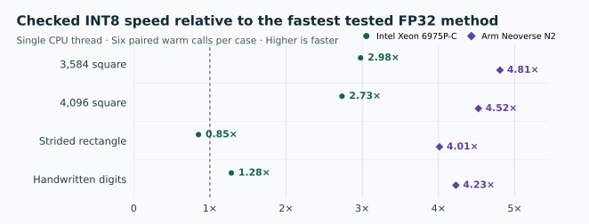

# COB GEMM

COB multiplies two row-major FP32 matrices on one CPU thread. It computes **C = A × B**, supports independent row strides and lets callers reuse either a packed B or both packed operands. The library has native kernels for Apple Silicon, Arm64 and x86-64.

## How fast is it?

**General FP32.** On an Apple M5 Max, COB beat all five tested libraries on a 9344 × 9344 square chosen before the run. It was **1.174×** as fast as MaxMulSK and won all six paired calls against it. Every implementation passed the full-output accuracy check. MaxMulSK led a separate 4096-square control. On Linux Neoverse N2, standalone COB led two of eight tested layouts, and COB with sequential OpenBLAS led two more. [Apple results by competitor](docs/audits/2026-11-25-ranking/earlier/README.md) · [Apple control](docs/audits/2026-11-25-strassen-sme.md) · [Linux results by layout](docs/audits/2026-11-25-ranking/bf16-components/README.md)

**FP32 inputs containing small integers.** An optional Linux library checks whether a product can be computed exactly with signed INT8 instructions. On a fresh 3584 × 3584 square, it took **138 ms on Intel** and **300 ms on Arm**. The fastest qualifying FP32 methods took **411 ms** and **1,447 ms**, respectively. The timings include checking the inputs, converting them, multiplying with sequential oneDNN and writing FP32 output. [Measured results and offline replay](docs/audits/2026-11-26-certified-inputs/README.md)



The Intel strided rectangle shows why shape matters. Input values also matter. When the last element of B was fractional, the check added 43% on Intel and 6.6% on Arm before the FP32 fallback finished the product. A dedicated bit-packed method led both CPUs on the binary handwriting images. [Competitors, fallback costs and application coverage](docs/audits/2026-11-26-certified-inputs/README.md)

## Build and run

With a C11 compiler and Make, build the test and benchmark executables, check correctness and time a square or a rectangle.

```sh
make
make test
./build/cob_gemm_bench 512
./build/cob_gemm_bench 832x960x896
```

The rectangular arguments are **M × N × K**. The rectangular example multiplies an 832 × 896 matrix by an 896 × 960 matrix.

To build and install the static library and C header with CMake, run the following commands.

```sh
cmake -S . -B build-release -DCMAKE_BUILD_TYPE=Release
cmake --build build-release --parallel
ctest --test-dir build-release --output-on-failure
cmake --install build-release --prefix "$PWD/install"
```

The default library dispatches by CPU and shape. On Linux, `-DCOB_BUILD_CHECKED_INT8=ON` builds a separate library with a C entry point and a caller-supplied FP32 fallback. [Checked INT8 setup and example](docs/checked-int8.md) · [Kernels and build options](docs/kernels.md)

## C API

```c
#include "cob_gemm.h"

int main(void) {
    float a[6] = {1, 2, 3, 4, 5, 6};
    float b[6] = {7, 8, 9, 10, 11, 12};
    float c[4];

    cob_sgemm_rowmajor(2, 2, 3, a, 3, b, 2, c, 2);
    return c[0] == 58 && c[1] == 64 && c[2] == 139 && c[3] == 154 ? 0 : 1;
}
```

The three leading dimensions are row strides in FP32 elements. The operation uses untransposed A and B with `alpha = 1` and `beta = 0`. If B stays fixed, pack it once and reuse it across calls.

```c
cob_packed_b_f32 packed_b = {0};
if (cob_sgemm_pack_b(&packed_b, k, n, b, ldb) == 0) {
    cob_sgemm_rowmajor_packed_b(m, n, k, a, lda, &packed_b, c, ldc);
    cob_sgemm_free_packed_b(&packed_b);
}
```

Callers reusing both operands can use `cob_sgemm_pack_a` and `cob_sgemm_rowmajor_packed_ab`. Release each packed object with its matching free function. [Public C API](include/cob_gemm.h)

## Reproduce the benchmarks

Warm one-shot timings include the work each implementation performs inside the call. Prepared inputs and first calls have separate results. GFLOP/s uses the classical operation count `2 × M × N × K` divided by elapsed time, including for algorithms that perform fewer products. [Benchmarking guide](docs/benchmarking.md) · [FP32 results by CPU and shape](docs/audits/2026-11-25-ranking/README.md) · [Checked integer results](docs/audits/2026-11-26-certified-inputs/README.md)

## License

COB uses the MIT license. The optional MaxMulSK-derived leaf uses Apache-2.0, and the Hopcroft–Kerr coefficient table uses BSD-2-Clause. The UCI handwriting fixtures are licensed under CC BY 4.0. [Dataset attribution](tools/world-rank/exact/fixtures/data/ATTRIBUTION.md) · [COB license](LICENSE) · [MaxMulSK license and notice](third_party/maxmulsk) · [Coefficient table and license](third_party/fast-matmul)
